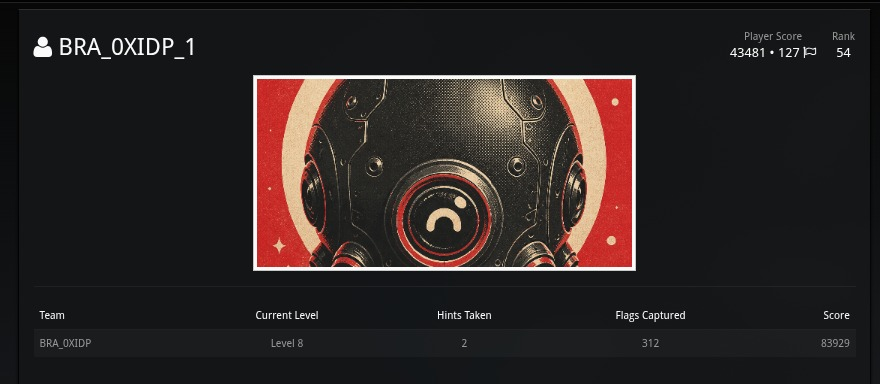
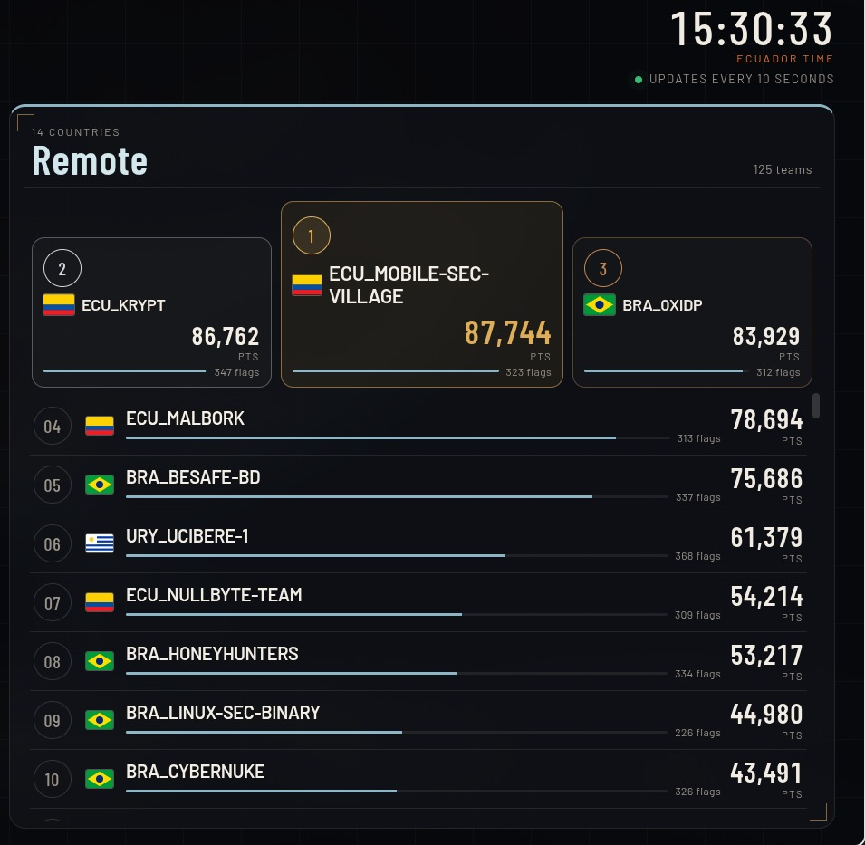

<b>🇧🇷 Português</b>

<h2>CENTINELA DIGITAL I — CTF</h2>

Writeups e artefatos dos desafios do <b>CTF Centinela Digital I</b> (Go Hacking), edição remota.

  <b>Plataforma:</b> <code>remoto.ctf.gohacking.com.br</code> 
  <b>Data:</b> 5 de novembro de 2026 · 09:00–15:30 (horário do Equador) · <b>Finalizado</b>

<h3>Resultado</h3>

🥇 <b>1º do Brasil</b> · 🥉 <b>3º geral</b> no ranking Remote (125 times, 14 países) · time <code>BRA_0XIDP</code> · 83.929 pts · 312 flags · Level 8 alcançado

Individual: <b>Felipebc2</b> · 43.481 pts · <b>127 flags</b> · especialidade Reverse + Pwn (boot2root).

<h3>Desafios</h3>

57 desafios documentados em 8 levels. Credenciais reais da plataforma foram anonimizadas (<code>&lt;HOST&gt;</code>, <code>&lt;USER&gt;</code>); IPs do lab, senhas derivadas no desafio e flags foram mantidos. 
As tabelas (nomes, pontos e status) estão na seção em inglês abaixo e valem para todos os idiomas. Todos os writeups seguem o <a href="WRITEUP_TEMPLATE.md"><code>WRITEUP_TEMPLATE.md</code></a>.

<b>🇪🇨 Español</b>

<h2>CENTINELA DIGITAL I — CTF</h2>

Writeups y artefactos de los desafíos del <b>CTF Centinela Digital I</b> (Go Hacking), edición remota.

  <b>Plataforma:</b> <code>remoto.ctf.gohacking.com.br</code> 
  <b>Fecha:</b> 5 de noviembre de 2026 · 09:00–15:30 (hora de Ecuador) · <b>Finalizado</b>

<h3>Resultado</h3>

🥇 <b>1º de Brasil</b> · 🥉 <b>3º general</b> en el ranking Remote (125 equipos, 14 países) · equipo <code>BRA_0XIDP</code> · 83.929 pts · 312 flags · Level 8 alcanzado

Individual: <b>Felipebc2</b> · 43.481 pts · <b>127 flags</b> · especialidad Reverse + Pwn (boot2root).

<h3>Desafíos</h3>

57 desafíos documentados en 8 levels. Las credenciales reales de la plataforma fueron anonimizadas (<code>&lt;HOST&gt;</code>, <code>&lt;USER&gt;</code>); se mantienen las IPs del lab, las contraseñas derivadas del reto y las flags. 
Las tablas (nombres, puntos y estado) están en la sección en inglés más abajo y aplican a todos los idiomas. Todos los writeups siguen el <a href="WRITEUP_TEMPLATE.md"><code>WRITEUP_TEMPLATE.md</code></a>.

<h1>CENTINELA DIGITAL I — CTF</h1>

Writeups and artifacts for the <b>Centinela Digital I CTF</b> (Go Hacking), remote edition.

  <b>Platform:</b> <code>remoto.ctf.gohacking.com.br</code> 
  <b>Date:</b> November 5, 2026 · 09:00–15:30 (Ecuador time) · <b>Finished</b>

<h2>Result</h2>

🥇 <b>1st in Brazil</b> · 🥉 <b>3rd overall</b> on the Remote scoreboard (125 teams · 14 countries)

<table>
  <tr><th>Team</th><th>Rank</th><th>Team score</th><th>Team flags</th><th>Level reached</th><th>Hints</th></tr>
  <tr><td><code>BRA_0XIDP</code></td><td><b>3rd</b> (1st 🇧🇷)</td><td>83,929</td><td>312</td><td>8 / 8</td><td>2</td></tr>
</table>
<table>
  <tr><th>Player</th><th>Specialty</th><th>Points</th><th>Flags</th><th>Player rank</th></tr>
  <tr><td><a href="https://github.com/Felipebc2">Felipebc2</a></td><td>Reverse · Pwn (boot2root)</td><td>43,481</td><td>127</td><td>54</td></tr>
  <!-- Teammates: copy the row above.
  <tr><td><a href="https://github.com/USER">USER</a></td><td>SPECIALTY</td><td>PTS</td><td>FLAGS</td><td>RANK</td></tr>
  -->
</table>

<h3>Felipebc2</h3>

<h2>Specialties</h2>

Flags documented in this repo, by category (accepted / available in the documented challenges).

<table>
  <tr><th>Category</th><th>Challenges</th><th>Fully solved</th><th>Flags</th></tr>
  <tr><td>Reverse</td><td>26</td><td>22</td><td>56 / 66</td></tr>
  <tr><td>Pwn / boot2root</td><td>17</td><td>10</td><td>49 / 68</td></tr>
  <tr><td>Crypto</td><td>6</td><td>6</td><td>13 / 13</td></tr>
  <tr><td>Forensics</td><td>4</td><td>4</td><td>8 / 8</td></tr>
  <tr><td>Misc</td><td>2</td><td>2</td><td>6 / 6</td></tr>
  <tr><td>AI / LLM</td><td>1</td><td>0</td><td>0 / 5</td></tr>
  <tr><td>Blue Team / SOC</td><td>1</td><td>0</td><td>0 / 11</td></tr>
  <tr><td><b>Total</b></td><td><b>57</b></td><td><b>44</b></td><td><b>132 / 177</b></td></tr>
</table>

<h2>Highest-value solves</h2>
<table>
  <tr><th>Challenge</th><th>Category</th><th>Level</th><th>Pts</th></tr>
  <tr><td><a href="Level6/Pwn/RadarMesh/">Radar Mesh</a></td><td>Pwn / boot2root</td><td>6</td><td>3,344</td></tr>
  <tr><td><a href="Level8/Forensics/LargeSystemHive/">Large System Hive</a></td><td>Forensics</td><td>8</td><td>2,800</td></tr>
  <tr><td><a href="Level5/Pwn/ConvoyOrders/">Convoy Orders</a></td><td>Pwn / boot2root</td><td>5</td><td>2,600</td></tr>
  <tr><td><a href="Level5/Pwn/RadioSpectrum/">Radio Spectrum</a></td><td>Pwn / boot2root</td><td>5</td><td>2,400</td></tr>
  <tr><td><a href="Level8/Forensics/LongCapture/">Long Capture</a></td><td>Forensics</td><td>8</td><td>2,320</td></tr>
  <tr><td><a href="Level8/Forensics/LargeDatabase/">Large Database</a></td><td>Forensics</td><td>8</td><td>2,140</td></tr>
</table>

<h2>Challenges</h2>

Real platform credentials and public infra hostnames were anonymized (<code>&lt;HOST&gt;</code>, <code>&lt;USER&gt;</code>). Lab IPs (<code>10.10.10.0/24</code>, gone after the event), challenge-derived passwords and flags were kept.
The four Level 8 forensics artifacts (≈1 GB each) are not in the repo; their sha256 is in each writeup. 
Every writeup follows <a href="WRITEUP_TEMPLATE.md"><code>WRITEUP_TEMPLATE.md</code></a> (header, flag table, TL;DR, analysis, what didn't work). 
Status: ✅ solved · 🟠 partial · ❌ unsolved. Difficulty: 🟢 easy · 🟡 medium · 🔴 hard · 🟣 insane.

<h3>Reverse</h3>
<table>
  <tr><th>Challenge</th><th>Code</th><th>Level</th><th>Diff</th><th>Flags</th><th>Pts</th><th>Status</th></tr>
  <tr><td><a href="Level1/Rev/SlipChecker/">Slip Checker</a></td><td><code>JID-Rev100</code></td><td>1</td><td>🟡</td><td>3/3</td><td>—</td><td>✅</td></tr>
  <tr><td><a href="Level1/Rev/DutyProgram/">Duty Program</a></td><td><code>JID-Rev101</code></td><td>1</td><td>🟡</td><td>3/3</td><td>—</td><td>✅</td></tr>
  <tr><td><a href="Level1/Rev/PierClient/">Pier Client</a></td><td><code>JID-Rev102</code></td><td>1</td><td>🟡</td><td>1/3</td><td>—</td><td>🟠</td></tr>
  <tr><td><a href="Level2/Rev/Handset/">Handset Image</a></td><td><code>JID-Rev103</code></td><td>2</td><td>🟡</td><td>2/2</td><td>—</td><td>✅</td></tr>
  <tr><td><a href="Level2/Rev/LedgerProgram/">Ledger Program</a></td><td><code>JID-Rev104</code></td><td>2</td><td>🟡</td><td>2/2</td><td>—</td><td>✅</td></tr>
  <tr><td><a href="Level2/Rev/SecondClass/">Second Class</a></td><td><code>JID-Rev105</code></td><td>2</td><td>🟡</td><td>2/2</td><td>—</td><td>✅</td></tr>
  <tr><td><a href="Level2/Rev/LicenseChecker/">License Checker</a></td><td><code>JID-Rev106</code></td><td>2</td><td>🟡</td><td>2/2</td><td>—</td><td>✅</td></tr>
  <tr><td><a href="Level3/Rev/PierScale/">Pier Scale</a></td><td><code>JID-Rev107</code></td><td>3</td><td>🟡</td><td>2/2</td><td>—</td><td>✅</td></tr>
  <tr><td><a href="Level3/Rev/RewrittenPage/">Rewritten Page</a></td><td><code>JID-Rev108</code></td><td>3</td><td>🟡</td><td>2/2</td><td>—</td><td>✅</td></tr>
  <tr><td><a href="Level3/Rev/ResetImage/">Reset Image</a></td><td><code>JID-Rev109</code></td><td>3</td><td>🟡</td><td>2/2</td><td>—</td><td>✅</td></tr>
  <tr><td><a href="Level3/Rev/RefusedSample/">Refused Sample</a></td><td><code>JID-Rev200</code></td><td>3</td><td>🔴</td><td>3/3</td><td>—</td><td>✅</td></tr>
  <tr><td><a href="Level4/Rev/TwoBuilds/">Two Builds</a></td><td><code>JID-Rev201</code></td><td>4</td><td>🔴</td><td>3/3</td><td>—</td><td>✅</td></tr>
  <tr><td><a href="Level4/Rev/PackedChecker/">Packed Checker</a></td><td><code>JID-Rev202</code></td><td>4</td><td>🔴</td><td>2/2</td><td>—</td><td>✅</td></tr>
  <tr><td><a href="Level4/Rev/ParserAndSlip/">Parser And Slip</a></td><td><code>JID-Rev203</code></td><td>4</td><td>🔴</td><td>3/3</td><td>—</td><td>✅</td></tr>
  <tr><td><a href="Level4/Rev/CipherSlip/">Cipher Slip</a></td><td><code>JID-Rev204</code></td><td>4</td><td>🔴</td><td>0/3</td><td>—</td><td>❌</td></tr>
  <tr><td><a href="Level4/Rev/ThreeFields/">Three Fields</a></td><td><code>JID-Rev205</code></td><td>4</td><td>🔴</td><td>3/3</td><td>—</td><td>✅</td></tr>
  <tr><td><a href="Level4/Rev/MidInstruction/">Mid Instruction</a></td><td><code>JID-Rev206</code></td><td>4</td><td>🔴</td><td>2/2</td><td>—</td><td>✅</td></tr>
  <tr><td><a href="Level4/Rev/NativeMethod/">Native Method</a></td><td><code>JID-Rev207</code></td><td>4</td><td>🔴</td><td>2/2</td><td>—</td><td>✅</td></tr>
  <tr><td><a href="Level4/Rev/CommandTape/">Command Tape</a></td><td><code>JID-Rev208</code></td><td>4</td><td>🔴</td><td>0/3</td><td>—</td><td>❌</td></tr>
  <tr><td><a href="Level4/Rev/ExceptionPath/">Exception Path</a></td><td><code>JID-Rev209</code></td><td>4</td><td>🔴</td><td>2/2</td><td>—</td><td>✅</td></tr>
  <tr><td><a href="Level4/Rev/Constructor/">Constructor</a></td><td><code>JID-Rev300</code></td><td>4</td><td>🔴</td><td>3/3</td><td>—</td><td>✅</td></tr>
  <tr><td><a href="Level4/Rev/SignalHandler/">Signal Handler</a></td><td><code>JID-Rev301</code></td><td>4</td><td>🔴</td><td>3/3</td><td>—</td><td>✅</td></tr>
  <tr><td><a href="Level4/Rev/LinkedLibraries/">Linked Libraries</a></td><td><code>JID-Rev302</code></td><td>4</td><td>🔴</td><td>3/3</td><td>—</td><td>✅</td></tr>
  <tr><td><a href="Level4/Rev/HiddenTally/">Hidden Tally</a></td><td><code>JID-Rev303</code></td><td>4</td><td>🔴</td><td>3/3</td><td>—</td><td>✅</td></tr>
  <tr><td><a href="Level4/Rev/GoChecker/">Go Checker</a></td><td><code>JID-Rev307</code></td><td>4</td><td>🔴</td><td>0/2</td><td>—</td><td>❌</td></tr>
  <tr><td><a href="Level4/Rev/GadgetChain/">Gadget Chain</a></td><td><code>JID-Rev308</code></td><td>4</td><td>🔴</td><td>3/3</td><td>—</td><td>✅</td></tr>
</table>
<h3>Pwn / boot2root</h3>
<table>
  <tr><th>Challenge</th><th>Code</th><th>Level</th><th>Diff</th><th>Flags</th><th>Pts</th><th>Status</th></tr>
  <tr><td><a href="Level1/Pwn/NightWatchRoster/">Night-Watch Roster</a></td><td><code>JID-Pwn100</code></td><td>1</td><td>🟢</td><td>1/4</td><td>100</td><td>🟠</td></tr>
  <tr><td><a href="Level1/Pwn/HarborWatch/">Harbor Watch</a></td><td><code>JID-Pwn101</code></td><td>1</td><td>🟢</td><td>4/4</td><td>725</td><td>✅</td></tr>
  <tr><td><a href="Level1/Pwn/EscortConvoy/">Escort Convoy</a></td><td><code>JID-Pwn103</code></td><td>1</td><td>🟢</td><td>4/4</td><td>812</td><td>✅</td></tr>
  <tr><td><a href="Level1/Pwn/VisitorBadges/">Visitor Badges</a></td><td><code>JID-Pwn106</code></td><td>1</td><td>🟢</td><td>4/4</td><td>1,025</td><td>✅</td></tr>
  <tr><td><a href="Level1/Pwn/RadioShack/">Radio Shack</a></td><td><code>JID-Pwn200</code></td><td>1</td><td>🟡</td><td>4/4</td><td>1,400</td><td>✅</td></tr>
  <tr><td><a href="Level1/Pwn/CoastalRadar/">Coastal Radar</a></td><td><code>JID-Pwn202</code></td><td>1</td><td>🟡</td><td>1/4</td><td>175</td><td>🟠</td></tr>
  <tr><td><a href="Level1/Pwn/EmbassyGate/">Embassy Gate</a></td><td><code>JID-Pwn204</code></td><td>1</td><td>🟡</td><td>4/4</td><td>1,800</td><td>✅</td></tr>
  <tr><td><a href="Level4/Pwn/AidShipments/">Aid Shipments</a></td><td><code>JID-Pwn203</code></td><td>4</td><td>🟡</td><td>4/4</td><td>1,700</td><td>✅</td></tr>
  <tr><td><a href="Level5/Pwn/BlackoutBridge/">Blackout Bridge</a></td><td><code>JID-Pwn300</code></td><td>5</td><td>🔴</td><td>1/4</td><td>200</td><td>🟠</td></tr>
  <tr><td><a href="Level5/Pwn/RadioSpectrum/">Radio Spectrum</a></td><td><code>JID-Pwn301</code></td><td>5</td><td>🔴</td><td>4/4</td><td>2,400</td><td>✅</td></tr>
  <tr><td><a href="Level5/Pwn/ConvoyOrders/">Convoy Orders</a></td><td><code>JID-Pwn302</code></td><td>5</td><td>🔴</td><td>4/4</td><td>2,600</td><td>✅</td></tr>
  <tr><td><a href="Level5/Pwn/LiaisonSwitchboard/">Liaison Switchboard</a></td><td><code>JID-Pwn303</code></td><td>5</td><td>🔴</td><td>4/4</td><td>—</td><td>✅</td></tr>
  <tr><td><a href="Level5/Pwn/CivilNightShift/">Civil Night Shift</a></td><td><code>JID-Pwn304</code></td><td>5</td><td>🔴</td><td>1/4</td><td>275</td><td>🟠</td></tr>
  <tr><td><a href="Level6/Pwn/RadarMesh/">Radar Mesh</a></td><td><code>JID-Pwn402</code></td><td>6</td><td>🟣</td><td>4/4</td><td>3,344</td><td>✅</td></tr>
  <tr><td><a href="Level6/Pwn/CommandPost/">Command Post</a></td><td><code>JID-Pwn404</code></td><td>6</td><td>🟣</td><td>1/4</td><td>350</td><td>🟠</td></tr>
  <tr><td><a href="Level7/Pwn/FusionCell/">Fusion Cell</a></td><td><code>JID-Pwn400</code></td><td>7</td><td>🟣</td><td>2/4</td><td>700</td><td>🟠</td></tr>
  <tr><td><a href="Level8/Pwn/TreatyOrders/">Treaty Orders</a></td><td><code>JID-Pwn401</code></td><td>8</td><td>🟣</td><td>2/4</td><td>—</td><td>🟠</td></tr>
</table>
<h3>Crypto</h3>
<table>
  <tr><th>Challenge</th><th>Code</th><th>Level</th><th>Diff</th><th>Flags</th><th>Pts</th><th>Status</th></tr>
  <tr><td><a href="Level1/Crypto/SmallModulus/">Small Modulus</a></td><td><code>JID-Crypto106</code></td><td>1</td><td>🟢</td><td>3/3</td><td>—</td><td>✅</td></tr>
  <tr><td><a href="Level2/Crypto/TwoAESBlobs/">Two AES Blobs</a></td><td><code>JID-Crypto107</code></td><td>2</td><td>🟢</td><td>3/3</td><td>—</td><td>✅</td></tr>
  <tr><td><a href="Level3/Crypto/FixedDistance/">Fixed Distance</a></td><td><code>JID-Crypto302</code></td><td>3</td><td>🔴</td><td>2/2</td><td>480</td><td>✅</td></tr>
  <tr><td><a href="Level3/Crypto/PartialState/">Partial State</a></td><td><code>JID-Crypto303</code></td><td>3</td><td>🔴</td><td>2/2</td><td>—</td><td>✅</td></tr>
  <tr><td><a href="Level4/Crypto/QuadraticShares/">Quadratic Shares</a></td><td><code>—</code></td><td>4</td><td>❓</td><td>1/1</td><td>—</td><td>✅</td></tr>
  <tr><td><a href="Level6/Crypto/SmoothOrder/">Smooth Order</a></td><td><code>JID-Crypto300</code></td><td>6</td><td>🔴</td><td>2/2</td><td>—</td><td>✅</td></tr>
</table>
<h3>Forensics</h3>
<table>
  <tr><th>Challenge</th><th>Code</th><th>Level</th><th>Diff</th><th>Flags</th><th>Pts</th><th>Status</th></tr>
  <tr><td><a href="Level8/Forensics/LongCapture/">Long Capture</a></td><td><code>JID-For400</code></td><td>8</td><td>🔴</td><td>2/2</td><td>2,320</td><td>✅</td></tr>
  <tr><td><a href="Level8/Forensics/LargeDatabase/">Large Database</a></td><td><code>JID-For401</code></td><td>8</td><td>🔴</td><td>2/2</td><td>2,140</td><td>✅</td></tr>
  <tr><td><a href="Level8/Forensics/LargeDiskImage/">Large Disk Image</a></td><td><code>JID-For402</code></td><td>8</td><td>🔴</td><td>2/2</td><td>—</td><td>✅</td></tr>
  <tr><td><a href="Level8/Forensics/LargeSystemHive/">Large System Hive</a></td><td><code>JID-For403</code></td><td>8</td><td>🔴</td><td>2/2</td><td>2,800</td><td>✅</td></tr>
</table>
<h3>Misc</h3>
<table>
  <tr><th>Challenge</th><th>Code</th><th>Level</th><th>Diff</th><th>Flags</th><th>Pts</th><th>Status</th></tr>
  <tr><td><a href="Level3/Misc/DutyRepository/">Duty Repository</a></td><td><code>JID-Misc300</code></td><td>3</td><td>🔴</td><td>3/3</td><td>980</td><td>✅</td></tr>
  <tr><td><a href="Level7/Misc/RadioNote/">Radio Note</a></td><td><code>JID-Misc303</code></td><td>7</td><td>🔴</td><td>3/3</td><td>980</td><td>✅</td></tr>
</table>
<h3>AI / LLM</h3>
<table>
  <tr><th>Challenge</th><th>Code</th><th>Level</th><th>Diff</th><th>Flags</th><th>Pts</th><th>Status</th></tr>
  <tr><td><a href="Level3/AI/AI300/">AI300</a></td><td><code>JID-AI300</code></td><td>3</td><td>🟡</td><td>0/5</td><td>0</td><td>❌</td></tr>
</table>
<h3>Blue Team / SOC</h3>
<table>
  <tr><th>Challenge</th><th>Code</th><th>Level</th><th>Diff</th><th>Flags</th><th>Pts</th><th>Status</th></tr>
  <tr><td><a href="Level8/BlueTeam/SOC700/">SOC700</a></td><td><code>JID-SOC700</code></td><td>8</td><td>🔴</td><td>0/11</td><td>—</td><td>❌</td></tr>
</table>

